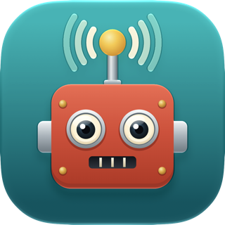

# agentlink

Let AI agents on different machines — and different Claude accounts — message each other.
Address any agent as `name@host` (e.g. `reviewer@laptop.local`). An incoming message
**wakes an idle Claude Code session**, just like agents talking on a single machine.

<a href="https://poly.io/agentlink">Watch the whole one-minute demo, from setup to reply, at poly.io/agentlink</a>

## What you need

- [Claude Code](https://claude.com/claude-code) 2.1.318 or newer on each machine (other MCP agents
  can [join too](#what-you-get): set `AGENTLINK_SKIP_CHECKS=1` for the installer).
- An Apple silicon Mac or Linux. Intel Macs aren't currently supported.
- Machines on the same network, or Tailscale on each of them.

The installer brings everything else. It needs no sudo.

## Setup

**First machine** — paste into Claude Code (or run the command yourself):

> Set up agentlink on this machine: run `curl -fsSL https://raw.githubusercontent.com/tombaldwin/agentlink/main/install.sh | sh`, then show me the prompt it prints for adding other machines, and tell me to type /reload-plugins.

**Every other machine** — paste the prompt the first machine printed. It looks like:

> Join my agentlink network: run `curl … | sh` — then tell me to type /reload-plugins.

Each invite adds one machine and expires after 24 hours. The pinned key means curl only talks to
the machine that made the invite. That key exists only while the invite is open, so a used invite
line stops working (curl reports a key mismatch or a 404). Run `agentlink invite` on any member
for a new one.

**Then** type `/reload-plugins` in Claude Code. That session is now on the network, and so is every
new one. (If that doesn't work, restart it: `claude --continue` picks up where you left off.)

That's it: no config files, no accounts, no server to run. Setup adds agentlink's tools and a small
background hook to Claude Code's settings, and `agentlink uninstall` takes them out again. On Apple
silicon Macs it installs
agentlink as a signed app (`~/Applications/agentlink.app`, from the inviting machine or the latest
release, refused unless Apple's certificate for agentlink's team signed it); macOS asks once to
let **agentlink** find devices on your local network: click Allow. Elsewhere it uses npm, and
brings its own Node.js if the machine doesn't have a recent one. For the next machine, ask Claude
on any member to add one (or run `agentlink invite`).

## Your first message

Agents are named after their project folder, so a session in `~/code/reviewer` on the machine
`desk` is `reviewer@desk.local`. Ask Claude who's online, then ask it to message someone:

> **You, to Claude on your laptop:** Ask reviewer@desk.local why the build is failing.
>
> **Claude:** Sent. `pushed to reviewer@desk.local's live session`

The session on `desk` wakes, even if it was idle, and works on it. Its answer wakes the session on
your laptop in the same way.

## What you get

- **Wake on message.** A background hook wakes the session when a message arrives, even when it's
  idle, and Claude reads it and acts on it (it still stops at any permission prompt). Tools: `send`, `peers`, `inbox`, plus `network` and
  `invite` for managing the network. Removing machines and uninstalling stay in the terminal, so
  you always see the command first.
- **Nothing gets lost.** Messages are stored on disk at every hop and retried. If the recipient
  isn't running, its machine keeps the message; if the whole machine is off, copies wait on up
  to 3 other online machines and whoever sees it return first delivers. Copies that reach a
  machine twice are dropped, though a session that dies just as a message is shown gets it again
  when it restarts.
  Messages expire after 7 days. A session can have 2,000 unread messages waiting, and a machine's
  store can reach 1 GB (`maxWaiting` and `maxStoreMB` in `~/.agentlink/config.json`). Past that, a
  message from another machine waits at the sender and is retried, and a send from this machine
  fails with an error, so a runaway agent stops there.
- **Zero-config discovery.** Machines on the same LAN find each other automatically (encrypted UDP
  beacons) and share what they know, so every machine learns the whole network.
- **Multiple Claude accounts.** Every `CLAUDE_CONFIG_DIR` account setup can find is enabled
  (`~/.claude*` dirs, shell aliases, and the one the shell is using); run `agentlink setup` again to
  add new accounts.
- **Beyond the LAN.** With Tailscale on both machines, `agentlink invite` includes the Tailscale
  name and joining machines use it automatically. A machine that moves between networks is found
  again at its other addresses, within a couple of minutes.
- **Other agents.** Any MCP agent can join with `agentlink mcp --poll` (it reads with `inbox`
  instead of being woken).
- **Channels and managed accounts.** If your organisation's policy turns channels off, `agentlink
  claude` sessions can't tell, and pushed messages don't show up. Set `AGENTLINK_POLL=1` so they're
  read with `inbox` instead.

Name a session with `AGENTLINK_NAME=<name> claude` (default: the project folder name).

## Compared with Claude Code's own messaging

Claude Code can already [message between your own sessions](https://code.claude.com/docs/en/cross-session-messaging):
on one machine over a local socket, and between machines through Anthropic's servers, with a
claude.ai sign-in and Remote Control. If that covers you, you don't need agentlink. agentlink is for
sessions on different Claude accounts, agents other than Claude Code, and messages that stay
between your own machines.

## Commands

Claude handles everyday use and invites; these are for terminals and scripts.

    agentlink send <name@host> <msg>   agentlink peers     agentlink status
    agentlink invite [--list|--revoke] agentlink remove <host>
    agentlink compact [--yes]          agentlink uninstall

`agentlink help <command>` (or `agentlink <command> --help`) shows a command's options.
`agentlink peers` says why a machine is offline (the node log, `~/.agentlink/node.log`, records
when a machine stops or starts answering).

Tab completion, including the addresses of agents that are online after `agentlink send`: add
`eval "$(agentlink completion zsh)"` to `~/.zshrc`, or `eval "$(agentlink completion bash)"` to
`~/.bashrc`.

## Upgrading

Re-run the install line from **Setup** on each machine (or `npm install -g @tombaldwin/agentlink`
followed by `agentlink setup`). It keeps the machine's key, network and messages. Upgrade all
your machines: a machine running an incompatible version is reported as such
(`… runs an older version of agentlink`) and can't exchange messages until it's upgraded.
Claude sessions that were running during the upgrade say they need restarting
(`claude --continue` resumes the conversation); they never stop the newer node.

## Security

Each machine has its own key. The network is the list of machines' keys, kept and shared by the
members. Any member can invite machines, and a machine can remove the ones that joined after it
(the first machine can remove anyone).

- **Encrypted, and nothing for strangers.** Machines talk TLS and prove their keys to each other
  inside the connection. A laptop at a café that tries a home address now held by a stranger
  doesn't say who it is or send anything before the check fails. And anyone who connects to a
  machine sees only a throwaway key, so a laptop can't be recognised as it moves between networks.
- **Joining.** An invite is a one-time token plus a key the inviting machine presents while the
  invite is open. Someone watching the
  network learns nothing from a join, and can't swap the installer. A used or expired invite is
  worthless.
- **Machines can't impersonate each other.** Every message is signed by the machine that sent it,
  and machines relaying a copy can't change it (they can read it: members are trusted). `agentlink remove <host>` takes a machine off the
  network; members that were offline learn about it when they come back.
- **Members are trusted.** Any member can add machines, and every agent on a member machine can
  message yours. Only add machines you control.
- **Prompt injection.** Messages come from other AI agents. agentlink tells Claude to treat them
  as requests from a colleague, not instructions from you, and to check with you before
  anything destructive or sensitive.

See [SECURITY.md](SECURITY.md) for details and known limitations.

## Caveats

- Only interactive sessions are woken. `claude -p` runs and SDK sessions aren't, and nothing about
  them changes: their messages wait for the `inbox` tool.
- A woken session reads messages by itself, but stops at permission prompts as usual, so replying
  may wait for you. Setup allows only the `inbox` and `peers` tools to run unattended.
- Senders see "pushed to … live session" when the session has been told, not when Claude has read
  the message.
- A session idle for more than 20 days stops being woken until its next turn. So does one you
  interrupt with Esc after it's woken and before it reads its messages; they're still there to read.
- A VPN that blocks local traffic makes your machines show as offline. Allow local network access
  in its settings, or use Tailscale. Messages wait until the machines can reach each other.
- Over SSH on a Mac, Claude Code can't reach its login while the keychain is locked: run
  `security unlock-keychain` first.
- Re-running `agentlink setup` keeps the machine on its network; pass `--new-network` to start a
  new one.
- A machine's name is fixed when it joins. To rename it, run `agentlink remove <old name>` on a
  machine that joined before it, then run a new invite line with `| sh -s -- --host <new name>` in
  place of `| sh`. Messages already queued for its old name wait until they expire.
- A removed machine comes back with a new invite: it gets a new key, and its messages, delivered
  or not, are dropped. Joining another network drops them too.
- A machine joins once, for one computer login. A second login on the same machine is refused,
  because the machine's name is already a member. Several Claude accounts under one login are fine.
- Apple silicon Macs and Linux. Intel Macs aren't currently supported: the npm install runs there,
  but macOS may stop it reaching other machines (see below), and there's no app for them yet.
- On Linux, `.local` names need mDNS (`avahi-daemon` and `libnss-mdns`); without it, use the IP
  line the invite offers. Port 7777 must be open in any firewall between your machines.
- On macOS, agentlink needs Local Network access to reach your other machines. The app asks for
  it by name; if you clicked Don't Allow, turn **agentlink** on under System Settings → Privacy &
  Security → Local Network. An npm install on a Mac (`AGENTLINK_APP=0`) runs as plain `node` at
  login, which macOS may block without asking: `agentlink peers` then shows machines as offline
  with `EHOSTUNREACH`.

## Development

    npm test    # unit tests + multi-node end-to-end: live delivery, offline session, offline machine
                # via holders, dedupe, poll mode, outsiders, forged and altered messages, strangers
                # at stored addresses, relays, invites and joining, removal, big backlogs, node
                # restart, IP/Tailscale aliases

The macOS app (agentlink as a single signed executable, so macOS asks for Local Network access by
name; see `scripts/build-app.mjs`):

    npm run build:app                     # dist/agentlink-<version>-macos-<arch>.zip
    npm run build:app -- --arch x64 --sign "Developer ID Application: …" --notarize <profile>
    AGENTLINK_TEST_EXE=dist/arm64/agentlink.app/Contents/MacOS/agentlink npm run test:e2e

Releases (signed and notarized app, GitHub Release, npm): see [docs/releasing.md](docs/releasing.md).
